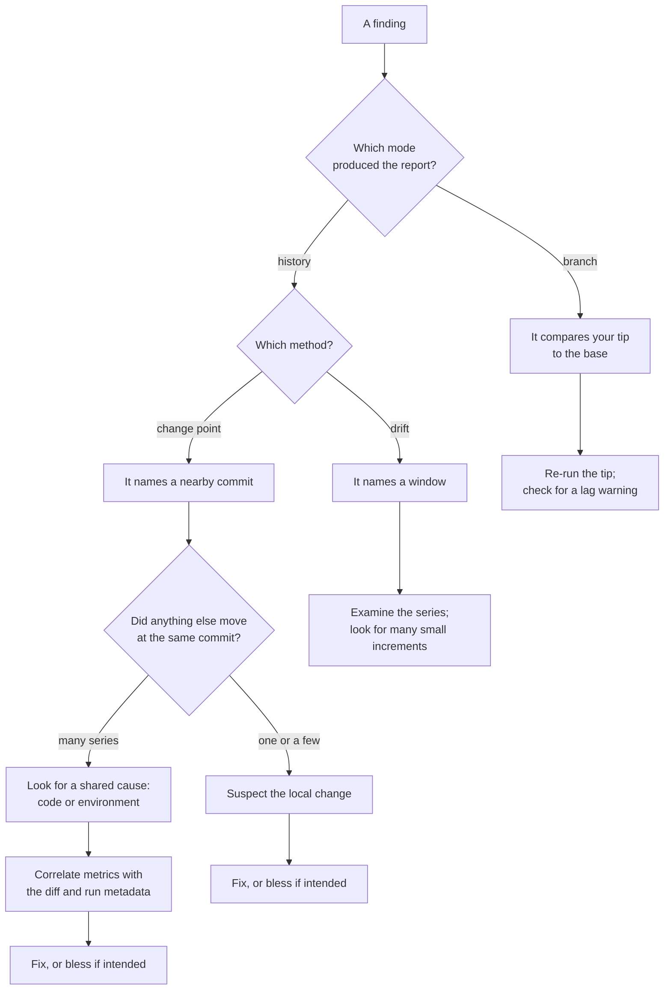
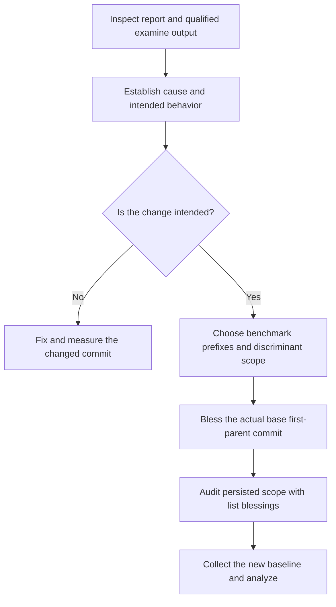

# Investigate and accept

Start with the report's commit, mode, coverage and freshness, then inspect its evidence.
The [report-reading chapter](reporting.md) explains those fields and includes worked
examples. This chapter helps decide what to do with your own result.

## Symptom to next action

| Symptom | Where to look | Next action |
| --- | --- | --- |
| The job failed or was cancelled | Workflow card, failing step and diagnostics | Resolve the execution failure. Do not interpret absent reports or completion files as clean or zero work. |
| Collection completed but nothing was stored | Verbose harvest diagnostics and actual native output roots | Check the selected targets/features and [engine artifacts](../concepts/engines.md#check-native-output). Establish the cause before widening scope. |
| Nothing was judged | Full Markdown Coverage section or JSON `census.reasons` | Inspect the selected partition and usable baseline; collect distinct comparable commits if evidence is missing. |
| Some series were judged, others were not | Per-reason census and `analyze --verbose` | Investigate the unjudged subset. Findings and partial evidence can coexist. |
| Analysis is clean but a platform is missing | Workflow card and collection jobs | Restore that platform's collection before treating the workflow as a complete all-clear. |
| The card is stale or freshness was not checked | Analyzed context and the live PR/base head | Find the run for the intended head. Do not infer age or distance from a mismatch. |
| Base comparison lags behind | Report's lag reason; `list discriminants` and `list runs` with report selectors | Check same-key base history and consider bounded backfill. |
| A rerun did not replace a stored value | Collection collision mode and retained current-collection snapshot | Distinguish new execution evidence from preserved storage before explicitly choosing overwrite. |
| A report selects no affected PR packages | Preparation's package-selection diagnostics | Check the diff and exclusions. Root-owned or unowned changes fall back to full-workspace scope, not a root-package limitation. |
| A finding returned after an attempted acceptance | `list blessings` at the selected anchor | Verify its stored prefixes, scope and base first-parent membership; do not assume a branch commit survives a squash merge. |

Start with the question you need to answer:

- **[I have a finding](#i-have-a-finding)** — something was reported and you need to act.
- **[Reading a silent report](#reading-a-silent-report)** — no findings were reported, and you
  need to know what was actually judged.
- **[I expected a finding and got none](#i-expected-a-finding-and-got-none)** — the checklist
  for tracking down where a real regression was dropped.

## I have a finding

<figure class="chart" tabindex="0" role="group" aria-label="Finding investigation; scroll horizontally on small screens">

</figure>

Note that the method named on a finding tells you which comparison produced it: `change point` and
`drift` come from history mode, `branch excursion` from branch mode. The report's header tells you
which mode ran.

### A change point

The finding names a commit **somewhere near** the change, not the exact first commit that
introduced the new level. A specific causal commit is not always identifiable; if collection
is sparse, the cause is somewhere in the gap before the named commit.

1. **Look at the series.** `cargo bench-history examine --benchmark <qualified-id> --metric <name>`
   prints every stored point. Both values come from the finding. The chart in the report is a
   summary; this is the data.
2. **Check whether the named commit has a neighbor gap.** If the previous observation is
   twenty commits back, your suspect list is those twenty commits, not one.
3. **Check what else moved.** Many simultaneous steps suggest a shared cause, not a specific
   one. The cause may be shared code such as an allocator, runtime or dependency, or an
   environment change such as the toolchain, runner, or hardware. Correlate the affected metrics
   with the commit diff and run metadata before attributing it.
4. **Decide.** Fix it, or accept it with [`bless`](../commands/bless.md), which re-baselines
   the series so it stops being re-reported.

### A drift

A drift names a window, not a commit, because that is what the evidence supports: no single
commit is responsible.

The usual cause is genuinely incremental — a container that grew, an abstraction that gained a
layer per change, a loop that got one more thing to do each month. That is exactly the class
of regression that comparing against the previous release will never catch, which is why the
tool looks for it.

1. **Examine the series** and look at the shape. A true drift climbs steadily.
2. **If it climbs in visible steps instead**, the drift detector won on residuals but the real
   story is several small change points. Bisect: analyze with `--context` set to a commit
   partway through the window, and see where the level sat then.
3. **Check the window's length.** A drift over a long window with sparse observations may be
   two distant levels with nothing in between. The chart shows the gaps to scale.

### A branch finding

Branch mode judges **only the analyzed context commit**, against the base ref's observed
current-regime range.
Your branch's intermediate commits are ignored — only the context state is evaluated.

1. **Re-run the benchmark on the context commit.** Branch findings rest on a small sample, often
   a single run. Inspect the new engine output directly: ordinary CI collection uses
   `--skip-existing`, which preserves existing stored measurements. Replacing stored results
   requires an explicit `collect --overwrite`.
2. **Look for a comparison-base lag warning.** On a rotating CI pool, your runner's machine key
   may only have base data from several commits back. The comparison is still valid, but it is
   against an older base state than you might assume.
3. **Check whether the base itself recently moved.** If the base stepped a few commits ago and
   your branch merely matches the new level, that is worth knowing before you go looking
   through your own diff.
4. **Read the comparable-base count literally.** It tells you how many eligible base commits
   produced at least as much report-wide out-of-range movement. It is historical context, not a
   confidence percentage.

## Accept an intentional change

Acceptance is a product decision about a measured tradeoff, not a way to repair
missing evidence. Record its rationale in the change or review discussion.

<figure class="chart" tabindex="0" role="group" aria-label="Scoped acceptance; scroll horizontally on small screens">

</figure>

Use the benchmark prefix from the finding, but choose engine/target/machine
restrictions from the **intent of the accepted change**, not just the machine where
you investigated it. With no restrictions, blessing applies across current and
future partitions for those prefixes. Avoid `--all` unless acceptance really covers
every benchmark, including future identities.

After a squash merge, bless the resulting base-branch commit, not the discarded
feature-branch SHA. Read the warnings if the anchor is off the base's first-parent
history or has no measured run. Then audit `list blessings` before relying on the
new baseline.

A blessing excludes earlier observations from detection without deleting them.
It can leave too little base evidence for branch comparison until new measurements
accumulate. [`bless / unbless`](../commands/bless.md) owns scope, anchor and revocation
rules; revocation deletes complete records, not individual prefixes within a record.

## Reading a silent report

"No notable changes detected" applies only to metric series that were actually **judged**.
One benchmark can contribute several metric series, so these counts are not benchmark counts.

### Where to find coverage

The GitHub issue or pull-request comment contains a **condensed summary**, not the full report.
When present, **Download the full report bundle** links to the full outputs:

- **Full Markdown** (`report.md` in the bundle, or the path passed to `--markdown`) ends with
  a **Coverage** section. It lists the coverage state, accounted-for, in-scope, judged and
  unjudged counts, and a count for each unjudged reason. It is present even when findings exist.
- **JSON** (`report.json` in the bundle, or the path passed to `--json`) carries the same
  account under `census`; the breakdown is `census.reasons`.
- **Text on stdout and condensed Markdown summaries** show the in-scope judged ratio in
  their headers when anything is in scope. Unjudged reasons and configured exclusions
  remain visible beside findings.

The warning about in-scope series that could not be judged refers to the full Markdown
**Coverage** section or the JSON **`census`**, not to additional detail hidden in the comment.
Publication can omit the bundle link. In that case, obtain the full outputs from the workflow
that produced the comment, or rerun [`analyze`](../commands/analyze.md) with the reported commit
and discriminant filters, adding `--markdown report.md --json report.json`. Use the same stored
measurements and selection to reproduce the report.

For individual series identities, rerun the same analysis with `--verbose`: its diagnostics
name each unjudged series, the evidence it carried and the rule that declined it.

### A silent analysis in Markdown and JSON

These examples are generated from the same analysis using the production renderers.
The Markdown example is file content, not terminal stdout; the JSON example contains its matching
`census` object.

{{#include generated/reporting-silent.md}}

### Interpreting the counts and reasons

The **in-scope** count excludes **ghosts**: metric series whose benchmark was not measured at
the analyzed context commit. A pull request often benchmarks only affected packages while the
analysis reads a wider history, so an untouched package's benchmarks can be ghosts. They still
appear in the accounted-for and unjudged totals and in the reason breakdown. They do not
prevent full coverage of the in-scope suite.

Configured [ignore prefixes](../commands/analyze.md#ignoring-benchmarks) also exclude
matching series from the in-scope count while preserving them in the total and reason
breakdown. They describe an intentional policy choice, not missing baseline evidence.
Removing a prefix restores eligibility of the stored measurements. If the suite contains
only ignored series and ghosts, its outcome is `nothing_in_scope`, not an all-clear.

The following reasons explain why series were not judged:

{{#include generated/coverage-reasons.md}}

`Judged 0 of N` means nothing was tested, not that measured levels stayed flat. Check the
reason breakdown: history may still be accumulating, a [blessing](../commands/bless.md) may
have limited usable evidence, or current measurements may be absent. When nothing is in
scope, the report says so instead of printing a ratio. When no series was accounted for,
it says nothing was analyzed.

The JSON `census.coverage` field and Markdown's Coverage state use the same tokens:
`no_series`, `nothing_in_scope`, `nothing_judged`, `partial` and `full`.
Only `full` means every in-scope series was judged. Even then, silence means no reportable
move survived the gates, not proof that nothing changed.

Findings do not imply full coverage: a report can identify a regression while leaving other
series unjudged. **Platform coverage** is separate again. A missing collection platform can
leave the available series fully judged without establishing an all-clear for every platform.

The tool reports that a measured level moved, not why it moved. Attributing a move and deciding
whether to accept it remain your judgment, recorded with [`bless`](../commands/bless.md).

## Unreliable or inconsistent hardware

**Symptoms:**

- Many unrelated benchmarks step at the same commit without a corresponding shared-code change.
- A series oscillates between two levels rather than wandering around one.
- Findings appear and disappear between runs with no code changes.
- The report's coverage drops, or comparison-base lag warnings appear.

**Diagnosis:**

- `cargo bench-history list discriminants` shows how your history is partitioned. Several
  machine keys where you expected one means the pool is rotating.
- `cargo bench-history machine-key --verbose` explains what the current machine hashed to and
  why.

**Remedies:**

- [`backfill`](../commands/backfill.md) on each machine so each key
  accumulates its own usable history.
- If evidence supports an intentional infrastructure change, choose the
  [acceptance scope](#accept-an-intentional-change) that it actually affects.

## Unreliable benchmarks

A noisy benchmark is not merely unpleasant — it is **actively harmful to detection**. In history
mode the [residual gate](gates.md) requires a move to exceed a multiple of the series' typical
residual. In branch mode every current-regime extreme expands the observed range the context must
clear. Noise does not just add false alarms; it hides real regressions.

**How to recognize one:**

- The series oscillates between two levels instead of varying around one. Usually a code path
  that gets taken sometimes: a cache that sometimes hits, an allocation that sometimes
  triggers a resize.
- Occasional points far from the rest. Usually the operating system — a scheduler decision,
  a page fault, another process.
- Drift that tracks nothing in your code. Often a data structure that grows across iterations.
- Values that differ run to run with no code or environment change. Usually **unseeded
  randomness** — most often the hashers behind `HashMap`/`HashSet`, whose seed is randomized per
  process, but also any randomized algorithm or sampled input — reshuffling the work each time.

**Fixes, roughly in order of effect:**

1. **Measure instruction counts instead of wall time** where you can. Callgrind's counts are
   the least noisy thing available, at the cost of not measuring what the user experiences.
2. **Pin instruction layout.** An unrelated dependency bump can move a hot loop across a cache
   line boundary and produce a phantom regression with no source change. See [Measurement
   stability](../concepts/stability.md).
3. **Use `--best-of N`** to take the minimum of several runs. Note the caveat below.
4. **Remove the variable path** from the benchmark itself: pre-warm caches, pre-size buffers,
   fix the input.
5. **Seed all randomness.** Every random choice a benchmark makes must come from a fixed seed,
   including the hashers behind `HashMap` and `HashSet` (their default seed is randomized per
   process) — otherwise each run measures a subtly different workload.

> **`--best-of` is a protocol, not a flag.** The stored value depends on how many repetitions
> you ran, so changing `N` shifts every series at once and reads as a suite-wide step. Pick a
> value and keep it. If you must change it, expect a step and bless it.

### Multithreaded and OS-waiting benchmarks

These deserve their own mention because they are the worst case.

A benchmark that waits on another thread, a lock, the filesystem, or the network is measuring
the operating system's scheduling decisions at least as much as your code. The scatter is
large, and it is not symmetric — waits have a floor and a long tail.

The consequence follows from the [residual gate](gates.md): the band widens until only
enormous moves clear it. The benchmark still runs, still records, still looks like coverage in
the census — and detects almost nothing.

*What to do instead:* measure the single-threaded work directly, and test concurrency
behavior with something other than a benchmark. If you must measure a concurrent path,
instruction counts degrade far more gracefully than wall time.

## I expected a finding and got none

Work down this list. Each step names the chapter that explains it.

1. **Was the series judged at all?** Read the full Markdown report's final Coverage section,
   the JSON `census`, or the verbose
   per-series reasoning. An unjudged series is never a silent skip — the reason is stated.
   → [Multiplicity and coverage](coverage.md)
2. **Is it a ghost?** If the benchmark did not run at the analyzed commit, every one of its
   metrics was dropped before detection. This is the single most common cause of a surprising
   silence. → [Reconstruction](reconstruction.md)
3. **Is there enough history?** Both sides of a step need enough commits. A benchmark added
   recently cannot produce a change point yet. A series that has just cleared the detection
   minimum is judged, but a lone step there cannot survive a large family's correction.
   → [Detection](detection.md),
   [Multiplicity and coverage](coverage.md#the-detection-minimum-is-not-a-reporting-guarantee)
4. **Does the move clear both floors?** Relative *and* absolute. A large percentage of a tiny
   number does not qualify. → [Noise gates](gates.md)
5. **Is the series too noisy?** In history mode, compare the move with the series' residual
   scatter. In branch mode, check whether historical extremes expanded the observed current-base
   range. → [Noise gates](gates.md)
6. **What does the report-wide context say?** For history, a larger judged family sets a stricter
   false-discovery bar — strict enough that a series at the detection minimum cannot report a
   lone step in a large family. For branch mode, read how many comparable base commits tied or
   exceeded the branch score.
   → [Multiplicity and coverage](coverage.md)
7. **Was it an improvement in history mode?** History mode watches for regressions only, so a
   move that made things faster never becomes a finding there. → [Reporting](reporting.md)
8. **Was it blessed?** A blessing re-baselines the series, so moves before the blessed commit
   are no longer considered. → [Reconstruction](reconstruction.md)

If none of these explains it, the fastest way to see exactly which check declined the
candidate is to look at the series directly with
[`examine`](../commands/examine.md) and compare it against the gate order in
[Noise gates](gates.md).
