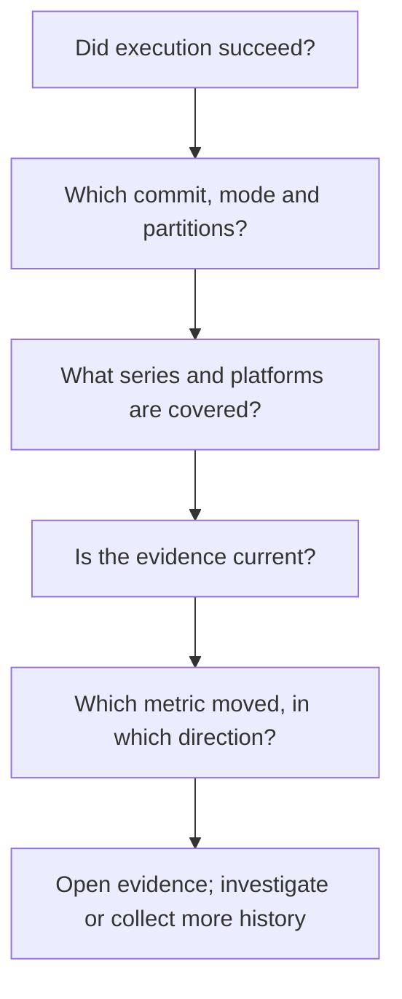

# Read a report

<a id="reporting"></a>

A report answers two questions together: **what moved, and what could be judged?**
Start with the worked examples, then use the reference sections below for the exact
meaning of each part. [Investigate and accept](insights.md) explains what to do next.

## Read in this order

<figure class="chart" tabindex="0" role="group" aria-label="Report anatomy; scroll horizontally on small screens">



</figure>

The workflow card describes execution and publication separately from analysis.
In the report, a **series** means one benchmark metric within one engine, target
and machine partition. A **census** accounts for judged and unjudged series.
Neither a successful job nor an empty findings table establishes complete evidence.

## Worked report gallery

These examples run maintained synthetic series through the **production detectors,
report renderers and workflow-card renderer**. They demonstrate output, not a real
repository run: project names, commit labels, run counts and workflow facts are
illustrative. No benchmark execution, Azure setup or hidden import command is required.
The example workflow links use a reserved, non-resolving domain.

### History: a step and a drift

Expand the evidence below the table to compare the step with the gradual climb.
History findings use **before and after representative levels**, not a latest
single measurement. Positive changes are regressions because the recorded metrics
are lower-is-better. Time values display a readable unit such as ns; JSON retains
the metric's original unit and precision.

{{#include generated/walkthrough-findings-summary.md:3:}}

The warning belongs beside the findings: this example detects changes while other
series lack enough evidence. A finding does not mean the entire suite was judged.

### PR-comment-style example

This is the same condensed projection used inside a PR comment. GitHub automation
adds its publication wrapper and links; this example does not claim a comment was
posted.

{{#include generated/walkthrough-pr.md:3:}}

| Part of the example | How to read it |
| --- | --- |
| Context and branch mode | The selected tip is the observation under judgment, not all intermediate branch commits. |
| Current base range | The low and high recorded values in the selected base regime. |
| Context measured | The branch observation, in the same displayed unit as the range. |
| Excess beyond range edge | The signed distance from the nearest edge, not a change from the base mean. |
| Comparable-base count | Observed historical context across the report; not a percentage probability of a regression. |
| Expandable evidence | Chart orientation, scale, gaps and full identity; real query-backed reports also supply qualified inspection commands. |

These synthetic reports have no repository to inspect, so they deliberately omit
copyable `examine` commands. Use commands supplied by your own report rather than
substituting the example's commit labels.

### Other successful analyses

These are different analysis outcomes, not different process exit codes. Expand
each example to see the production wording and its coverage account.

<details>
<summary>Clean: every in-scope series was judged, without findings</summary>

{{#include generated/walkthrough-clean-summary.md:3:}}

Continue collecting. This says nothing about a collection platform absent from the
analysis; [platform completeness is a separate check](#analysis-outcomes).

</details>

<details>
<summary>Insufficient baseline: no in-scope series could be judged</summary>

{{#include generated/walkthrough-insufficient_baseline-summary.md:3:}}

Check the selected partition and collect or backfill distinct comparable commits.
Repeating one commit does not create independent history.

</details>

<details>
<summary>Partial: some series were judged, others were not</summary>

{{#include generated/walkthrough-partial-summary.md:3:}}

Read the per-reason account before interpreting the silence. Investigate the
unjudged subset rather than accepting the whole suite as clean.

</details>

<details>
<summary>Nothing in scope: only absent or intentionally ignored series remain</summary>

{{#include generated/walkthrough-nothing_in_scope-summary.md:3:}}

Inspect collection scope and configuration. Missing output alone does not identify
a cause; [troubleshooting](insights.md#symptom-to-next-action) starts from the evidence.

</details>

### Workflow result card

This generated example selects a single platform to keep the illustration compact;
it does not represent the reusable workflows' default matrix.

{{#include generated/walkthrough-workflow.md:3:}}

**Execution** answers whether the work completed. **Analysis** and **judged coverage**
describe the evidence. **Completed/missing platforms** describe collection jobs.
**GitHub publication** describes the write request, not storage, and
**freshness** compares the analyzed commit with an explicitly observed head.
The example disables publication without claiming collection was a dry run.

<details>
<summary>Stale evidence: the same analysis no longer matches the observed head</summary>

{{#include generated/walkthrough-stale.md:3:}}

Open the run for the current head before acting. The differing IDs establish
staleness, not elapsed time or commit distance. Without a live-head observation the
card says freshness was not checked. Comparison-base lag, described below, is a
different question: how recent the comparable base measurements are.

</details>

### Download the worked reports

These complete projections are generated together with the excerpts above. Markdown
downloads use the `.markdown` extension so the book serves them as source documents.
JSON contains analysis, not a reusable observation archive.

| Example | Text | Markdown | JSON |
| --- | --- | --- | --- |
| History step and drift | [Text](generated/walkthrough-findings.txt) | [Markdown](generated/walkthrough-findings.markdown) | [JSON](generated/walkthrough-findings.json) |
| Branch excursion | [Text](generated/walkthrough-branch.txt) | [Markdown](generated/walkthrough-branch.markdown) | [JSON](generated/walkthrough-branch.json) |
| Clean | [Text](generated/walkthrough-clean.txt) | [Markdown](generated/walkthrough-clean.markdown) | [JSON](generated/walkthrough-clean.json) |
| Insufficient baseline | [Text](generated/walkthrough-insufficient_baseline.txt) | [Markdown](generated/walkthrough-insufficient_baseline.markdown) | [JSON](generated/walkthrough-insufficient_baseline.json) |
| Partial | [Text](generated/walkthrough-partial.txt) | [Markdown](generated/walkthrough-partial.markdown) | [JSON](generated/walkthrough-partial.json) |
| Nothing in scope | [Text](generated/walkthrough-nothing_in_scope.txt) | [Markdown](generated/walkthrough-nothing_in_scope.markdown) | [JSON](generated/walkthrough-nothing_in_scope.json) |

## Report reference

### Terms used here

{{#include generated/terms-reporting.md}}

## Ranking

Findings are ordered by **descending relative move**, then by analysis method, then by a stable
identity tie-break so two runs over the same data produce the same order.

There is deliberately **no severity classification**. Whether a 4% regression in a hot path
matters more than a 40% regression in a rarely-used one is a judgment about your project, and
the tool does not have the information to make it. It sorts by the one quantity it can
measure, and leaves the ranking of importance to you.

Note in particular that history findings carry **no** confidence score to sort by. Every
reported history finding already cleared its test, so any such number would be uniformly high
and would rank almost nothing — see
[Detection](detection.md#history-chance-levels-not-a-confidence-score). Branch findings report
an observed range plus report-wide historical context instead of a probability score.

## Reading a finding

{{#include generated/reporting-finding-annotated.md}}

History values describe **before and after representative levels**, not the latest single
measurement. Quantities include their units; time and byte values use a readable scale shared
with the finding's chart. JSON retains the metric's original numeric unit and full precision.

The chart states its orientation, scale and comparison context. It is drawn against **topology**,
not against the observations. One column per commit,
so a gap is a gap and the trailing stretch after the last observation is visible as one. That
matters: a chart that packed the observations together would hide exactly the sparseness that
[detection cannot see](reconstruction.md#gaps-are-holes-not-zeroes).

Illustrated figures have a text description and labelled or shaped distinctions,
not color alone. On a narrow screen, focus the figure and scroll horizontally to
keep its labels readable instead of shrinking the whole chart.

Where a series has more commits than the chart has columns, commits are grouped before
plotting. Grouping first is deliberate — the alternative attenuates an isolated observation
surrounded by gaps into nothing.

## Analysis outcomes

The **analysis outcome** is the result of a successful analysis, combining findings with the
[series coverage state](coverage.md#reading-a-silent-report). Findings take precedence: an
analysis with any findings has outcome `findings`, even when some series could not be judged.

Without findings, a fully judged in-scope suite is `clean`. An in-scope suite with no judged
series is `insufficient_baseline`; a suite with some judged and some unjudged series is
`partial`. When no series entered analysis, or every accounted series was absent at the
analyzed context commit or ignored by configuration, the outcome is `nothing_in_scope`.

These outcomes describe the series available to analysis, not an inventory of collection jobs.
**Platform coverage** is separate: matrix automation must verify which expected platforms
completed collection before presenting a complete all-clear. A missing collection leg can
coexist with a `clean` analysis of the available series. Analysis failure is an execution
error, not an outcome.

## The formats

The tool emits reports and their derived outputs in these forms, each requested independently:

- **Text** — the default terminal report.
- **Markdown** (`--markdown <path>`) — every finding plus complete coverage counts and reasons,
  for a pull request or an issue.
- **JSON** (`--json <path>`) — the complete machine-readable result.
- **Condensed summary** (`--markdown-summary <path>`, `analyze` only) — a short, capped Markdown
  digest for a size-limited destination such as a pull request comment.
- **Outcome** (`--outcome <path>`, `analyze` only) — the stable [analysis outcome](#analysis-outcomes)
  for selecting a message without parsing the full JSON report.

Full Markdown carries every finding and ends with a **Coverage** section containing the complete
counts and unjudged-reason breakdown, including ghosts. **JSON always carries the complete census**
under `census`, which makes it the machine-readable signal: each finding
self-describing, plus every unjudged reason. Text also states the unjudged reason counts. JSON
deliberately omits the per-commit chart series — that is presentation, and
[`examine`](../commands/examine.md) is the way to get the underlying points. The **condensed
summary** is lossy by design — a capped findings table with expandable evidence — so it is
the one output you must not automate against. The outcome file repeats only the JSON report's
top-level `outcome` field; it carries no report details. The full table is under
[Where output goes](#where-output-goes).

Here is the same analysis in text and JSON. The JSON excerpt illustrates the shape automation
reads, not a complete field catalog. For matching full Markdown and JSON examples, see
[Reading a silent report](insights.md#reading-a-silent-report).

{{#include generated/reporting-text.md}}

{{#include generated/reporting-json.md}}

## Findings never fail the build

The exit code reflects whether the analysis **ran**. A report full of regressions exits
successfully; a report that could not reach its storage backend does not.

*Why:* a benchmark tool that breaks builds on a measurement gets disabled, and a disabled tool
detects nothing. Findings are advisory by design.

*What this means for automation:* write the JSON report to a file with `--json`. Its top-level
`outcome` field carries the [analysis outcome](#analysis-outcomes); the `notable` boolean is
`true` exactly for `findings`. Use `--outcome <path>` when this value is all the caller needs,
and retain separate collection evidence for matrix-wide claims. The full JSON remains
necessary for counts, reasons and findings.

## The coverage line is not decoration

Text and Markdown headers state how many in-scope series were judged when anything was in scope.
JSON records those counts in `census`. This terminal example shows a silent report:

{{#include generated/reporting-census.md}}

This is given the same prominence as the findings on purpose. "No notable changes" means
*nothing changed among the series this run was able to judge*, and without the denominator you
cannot tell that statement apart from "the benchmarks did not run".

The final **Coverage** section in full Markdown and the JSON `census` always contain the
**reasons** series went unjudged, including when findings exist. Text and condensed summaries
also state reason counts beside findings. Configured exclusions
also receive a compact disclosure beside findings, so an intentional reduction in
analysis scope stays visible. When in-scope series remain unjudged, an explicit warning keeps
that incomplete coverage visible beside findings. Summary caps do not remove this warning or
the full-analysis lag and historical-comparison qualifications. See
[Reading a silent report](insights.md#reading-a-silent-report) for matching Markdown and JSON
examples.

## Comparison-base lag

Branch mode compares the analyzed context commit against the base ref's recent commits **within
the same discriminant set**. On a rotating CI pool, the newest base-ref commits may only carry
data under a different machine key — so your runner compares against base data from several
commits back.

<figure class="chart" tabindex="0" role="group" aria-label="Chart; scroll horizontally on small screens">
{{#include generated/reporting-lag.svg}}
</figure>

The empty stretch after the comparison base is the lag: commits that exist on the base ref, but
not for the context run's machine key.

The report says so, naming how far behind and which of two reasons applies:

{{#include generated/reporting-lag.md}}

It is advisory. It never changes which findings are reported, and never affects the exit code.
What it changes is how much weight you should give a marginal branch finding: a comparison
against a base state ten commits old is a comparison against a base state ten commits old.

## Branch range and historical context

A branch finding does not borrow history-mode change-point wording. It states the measured context
value, the lowest and highest values observed in the selected current-base regime, and the excess
beyond the nearest edge. "Slower than all 20 current-base observations" is a claim about those
recorded observations, not a probability estimate.

The discriminant-set section then gives the report-wide historical comparison, for example:

```text
None of 10 comparable base commits showed as much out-of-range movement as this branch
(12 series compared).
```

When too little shared history exists, the report says the comparison could not be formed and
still prints every factual range excursion. JSON exposes the same distinction: finding-level
`branch` range metadata and set-level `branch_comparison` counts.

## Inspecting the evidence

Finding evidence includes copyable `examine` commands when the report has the original query
location. Choose the labelled shell syntax. The commands pin the benchmark, metric, engine,
target, machine, context, base and resolved time window, and retain the repository,
configuration and storage context. Branch reports include a separate clean-base command:
the base may have advanced independently of the branch.

These are raw stored-data inspections, not a rerun of detection. If the report used exact
collection snapshots, its current measurements may differ from shared storage; the report
states that limitation. Keep those snapshots for the original current-value evidence.
Configuration, stored observations and dirty working-tree state can also change after reporting.
Do not replace the explicit selectors with local defaults when inspecting a CI report.

## Where output goes

The text report goes to **stdout**. Diagnostics, the effective-selection summary and verbose
notes go to **stderr**.

Warnings are the exception, and it is deliberate: a comparison-base lag notice, or the note that
a dirty run was admitted on the base tip, is rendered **into the report body** rather than onto
stderr. Those qualify the findings printed beside them, so a reader who captured only the report
would otherwise lose the caveat that changes how to read it.

The other formats are written to files rather than to a stream — `--markdown`, `--json`,
`--markdown-summary` and `--outcome` each take a path, and `--no-text` suppresses the stdout
report when you want only those.

{{#include generated/reporting-formats.md}}

## What comes next

Follow [Investigate and accept](insights.md) for a finding or unexpected silence.
For a new baseline, use [Operate benchmark history](../operations.md).
