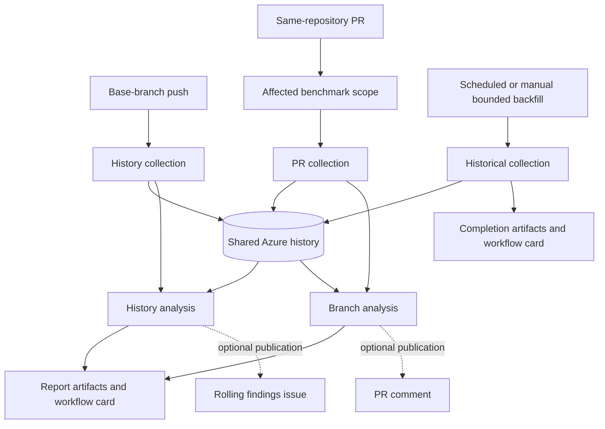

# Connect GitHub

<a id="github-automation"></a>

Use the [reusable workflows](https://github.com/folo-rs/cargo-bench-history-action)
for the complete collection, analysis and reporting path. Start with base-branch
history, verify its first visible result, bootstrap comparable evidence, then add
PR comparisons. This guide uses `main` as the history branch; substitute your real
branch consistently, including Azure federation.

<figure class="chart" tabindex="0" role="group" aria-label="Workflow journey; scroll horizontally on small screens">



</figure>

The **root action** is a lower-level building block for manually composed jobs.
It does not replace the reusable workflows' checkout, matrix orchestration,
prerequisite setup, artifact reconciliation and lifecycle handling. Use the
[action's root commands and inputs](https://github.com/folo-rs/cargo-bench-history-action#root-commands-and-inputs)
when composing that path; do not combine its installation assumptions with this guide.

## 1. Check engines, platforms and features

Verify a [supported benchmark target and its native artifacts](concepts/engines.md#check-native-output)
locally first. A successful Cargo build alone does not show that a measurement target ran.
Choose platforms your benchmarks and dependencies support.

Reusable workflows select Linux and Windows by default. The action also documents
Apple Silicon macOS support; opt into it only for compatible targets. Consult the
selected action release for supported runner/target pairs and prepared native tools,
rather than assuming every engine runs on every runner.

The reusable workflows enable `all-features` by default. For a narrower feature
selection, set `all-features: false` and the intended `features` and
`no-default-features` inputs consistently in **history, PR and backfill**.
Choose a stable `best-of` repetition count and matching compiler flags as part of
the same protocol. `--engine` is an analysis filter, not a collection selector.

## 2. Create the project configuration

Run `cargo bench-history install` from the repository root for a commented starter
`.cargo/bench_history.toml`. Choose a stable project ID now; fill in the Azure values
from the next step before committing:

```toml
[project]
id = "textproc"

[storage.azure]
account = "myhistoryaccount"
container = "bench-history"
```

The names illustrate the fields, not existing resources. Local storage paths stay
out of this shared file. [Ignore prefixes](commands/analyze.md#ignoring-benchmarks)
are optional analysis policy; they do not shrink collection or platform-completeness
accounting.

<a id="1-set-up-azure-storage"></a>

## 3. Provision Azure through the canonical setup

Follow [`setup-azure`](commands/setup-azure.md) for the reviewable deployment bundle,
prerequisites and deployment command. Use the same GitHub repository and history
branch as these callers. Copy the resulting account and container into the config,
and retain the printed client and tenant IDs.

The setup owns Azure resource and identity provisioning. It does not install
benchmark prerequisites, create repository variables or commit caller workflows.
Do not replace it with a separately maintained cloud recipe.

## 4. Add repository variables

In **Settings → Secrets and variables → Actions → Variables**, set:

| Variable | Setup output |
| --- | --- |
| `AZURE_CLIENT_ID` | Managed identity client ID |
| `AZURE_TENANT_ID` | Azure tenant ID |

These are identifiers, not secrets. The workflows use short-lived federated identity
tokens; no stored credential or `azure/login` step is needed. Authentication failures
remain failures rather than switching to another credential.

<a id="2-add-the-history-workflow"></a>

## 5. Add the history caller

Create `.github/workflows/benchmark-history.yml`:

```yaml
name: Benchmark history

on:
  push:
    branches: [main]
  workflow_dispatch:

jobs:
  history:
    if: github.ref == 'refs/heads/main'
    permissions:
      contents: read
      actions: read
      id-token: write
      issues: write
    uses: folo-rs/cargo-bench-history-action/.github/workflows/history.yml@v3
    with:
      azure-client-id: ${{ vars.AZURE_CLIENT_ID }}
      azure-tenant-id: ${{ vars.AZURE_TENANT_ID }}
```

Use the same chosen action release across callers. The reusable workflow owns
checkout, tool installation, collection, analysis, artifacts and the result card.
Issue publication is enabled by default. `publish: false` disables public issue
writes, **not collection or storage writes**. A true local collection dry run is
[`collect --no-store`](commands/collect.md#storage-behavior), not this publication setting.

### Optional repository setup hook

If your targets need repository-specific preparation beyond the workflow's setup,
provide `.github/actions/bench-history-setup/action.yml`. For example, a repository
that already owns a fixture-preparation script can invoke it:

```yaml
name: Prepare benchmark fixtures
description: Prepare this repository's input data before measurement
runs:
  using: composite
  steps:
    - shell: pwsh
      run: ./scripts/prepare-benchmark-fixtures.ps1
```

The script in this illustration is **your repository's script**, not supplied by the
history tool. It must support the chosen platforms and prepare reproducible inputs
without changing benchmark identity or protocol unintentionally. The fixed hook comes
from the invocation checkout, including during backfill, not each historical commit.
See the [workflow configuration and hook documentation](https://github.com/folo-rs/cargo-bench-history-action#workflow-configuration)
for the execution boundary and complete setup rules. Use the workflows' `rustflags`
input for shared compiler options rather than maintaining a second flag-composition recipe.

<a id="5-read-the-reports"></a>

## 6. Inspect the first visible result

Commit the configuration and caller to the history branch. Open **Actions → Benchmark
history**, or dispatch that workflow on the history branch.

Start at the workflow's **Benchmark workflow results** card. It separates execution,
analysis outcome, judged-series coverage, expected/completed platforms, freshness and
GitHub publication, and links the available evidence. Then download the
`bench-history-report-…` artifact: the full Markdown, JSON and condensed summary
are different views of the analysis, not separate benchmark executions.

Use an action release that includes workflow result cards. If setup fails before
the tool is available, the workflow can only show execution diagnostics, not a validated
benchmark verdict. Hard cancellation can prevent a final summary write. Missing
card or artifact evidence is a reason to inspect the run, never an all-clear.

Expect **insufficient baseline** on a new history. The
[report gallery](appendix/reporting.md#worked-report-gallery) shows what to look for.
No issue on the first run is normal: only findings create the rolling
`Benchmark history findings for …` issue. A later fully covered clean report marks an
existing issue all-clear but leaves it open. Inconclusive evidence cannot clear it.

Execution failures are separate. A failed history workflow attempts a
`Benchmark history workflow failed for …` alert when publication is enabled.
Successful later runs do not close those alerts.

<a id="4-fill-gaps-with-backfill"></a>

## 7. Bootstrap comparable base history

Keep collecting as commits reach the base, or add
`.github/workflows/benchmark-backfill.yml` for deliberate bounded replay:

```yaml
name: Benchmark backfill

on:
  workflow_dispatch:
    inputs:
      from:
        description: Oldest first-parent commit to include
        required: true
        type: string
      to:
        description: Newest first-parent commit to include
        required: true
        type: string

jobs:
  backfill:
    if: github.ref == 'refs/heads/main'
    permissions:
      contents: read
      actions: read
      id-token: write
    uses: folo-rs/cargo-bench-history-action/.github/workflows/backfill.yml@v3
    with:
      azure-client-id: ${{ vars.AZURE_CLIENT_ID }}
      azure-tenant-id: ${{ vars.AZURE_TENANT_ID }}
      from: ${{ inputs.from }}
      to: ${{ inputs.to }}
      # Start with a small attempt budget before scheduling broader replay.
      max-commits: '1'
```

Dispatch on the history branch, with a reviewed range from the base's first-parent
history. Preparation freezes its inclusive endpoints. Execution visits missing
commits newest-first in the runner's own partition. The bound limits attempted
commits, not duration. Repeating the same range and protocol fills the next missing
commits without replacing existing clean data.

The completion card and artifacts account for stored, skipped, empty, failed and
deferred commits when final evidence is available. They carry **no benchmark verdict**:
backfill collects only, and later history analysis uses that data. A timeout or
infrastructure failure can leave partial writes without final accounting.

For scheduled replay, the owning [backfill workflow documentation](https://github.com/folo-rs/cargo-bench-history-action#backfill-historical-measurements)
describes `lookback`, `minimum-age`, optional endpoint overrides and queue behavior.
Do not mix explicit `from` with rolling-range inputs. Start with an intentional cost
budget rather than assuming a calendar span guarantees readiness. See
[baseline operations](operations.md#bootstrap-and-check-a-baseline) and the
[core backfill contract](commands/backfill.md).

<a id="3-add-the-pull-request-workflow"></a>

## 8. Add the PR caller

Create `.github/workflows/benchmark-pr.yml`:

```yaml
name: Benchmark pull request

on:
  pull_request:
    branches: [main]
    types: [opened, synchronize, reopened, closed]

jobs:
  benchmark:
    if: github.event.pull_request.head.repo.full_name == github.repository
    permissions:
      contents: read
      actions: read
      id-token: write
      pull-requests: write
    uses: folo-rs/cargo-bench-history-action/.github/workflows/pr.yml@v3
    with:
      azure-client-id: ${{ vars.AZURE_CLIENT_ID }}
      azure-tenant-id: ${{ vars.AZURE_TENANT_ID }}
```

Commit the caller to the base branch, then open a same-repository PR changing
benchmarked code. Preparation selects affected benchmark packages; root-owned or
unowned changes fall back to the workspace rather than silently ignoring them.
No selected packages produces an explicit empty-scope result, not measured clean evidence.

With publication enabled, the workflow maintains one PR comment: pending or stale
while work runs, then findings, clean or inconclusive with the available artifact link.
It also produces the workflow card and `pr-bench-history-report-…` artifact.
Pushing a new commit updates the same comment; closing the PR cancels outstanding work.
`publish: false` disables comment writes but still permits collection, storage and
analysis. A complete all-clear requires both judged in-scope series and completed
expected platforms.

### Same-repository and fork boundary

The reusable workflow skips fork-origin PRs. GitHub's default fork permission policy
removes the OIDC write permission needed for Azure access; approving a run does not
restore it. A workflow running in the fork uses the fork's identity, not the target
repository's Azure trust.

Azure's repository PR subject is **not a fork-head filter**. Keep the explicit
same-repository policy and do not substitute a privileged `pull_request_target`
checkout of untrusted head code. Fork benchmarking needs a separate authorization
design; it is not a setup step in this guide.

## Next: use and maintain the evidence

Use [Investigate and accept](appendix/insights.md) for report-driven decisions.
[Operate benchmark history](operations.md) covers reruns, scope, baseline effects,
cost, storage/artifact retention and upgrades. The
[action repository](https://github.com/folo-rs/cargo-bench-history-action#workflow-configuration)
owns the complete reusable-workflow and action-only input matrices.
