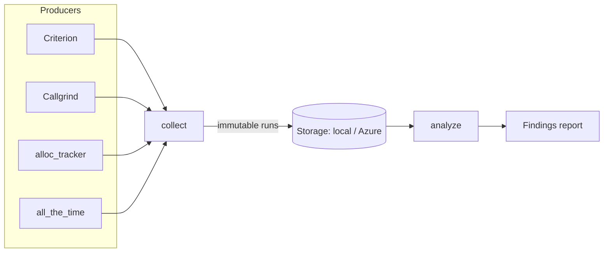

# Introduction

`cargo-bench-history` is a Cargo subcommand that maintains a long-lived history of
benchmark results and analyzes it for trends that snapshot-only tooling cannot see — for
example "benchmark X has been getting incrementally slower over the past 12 months" or
"scenario Y regressed after commit Z, visible only in hindsight against noisy data".

Most benchmark tooling only reports the current run, or at best compares against the
previous local run. `cargo-bench-history` instead stores **every** run as an immutable
record — on the local filesystem or in an Azure Blob container — and reconstructs
per-benchmark series in git first-parent commit order, so historical trends become
analyzable.

<figure class="chart" tabindex="0" role="group" aria-label="Benchmark data flow; scroll horizontally on small screens">

</figure>

History analysis looks for regressions: a step near a commit or drift across a window.
Pull-request analysis compares the selected branch tip with the base's observed range
and reports both regressions and improvements. A finding describes a measurement,
not its cause or importance. Findings are advisory; an execution error is different
from an unfavorable result.

## See the result before setting up storage

The [report walkthrough](appendix/reporting.md#worked-report-gallery) contains
production-generated examples of a step, drift and inconclusive evidence, plus a
PR-comment-style summary and an Actions result card. You can read or download the
reports without running benchmarks or connecting Azure. These are worked examples,
not measurements of your repository.

## Choose your next task

| Task | Start here |
| --- | --- |
| Get one local collection and inspect what it stored | [Try locally](getting-started.md) |
| Understand a finding, an all-clear or missing evidence | [Read a report](appendix/reporting.md) |
| Collect shared history and compare pull requests | [Connect GitHub](github-automation.md) |
| Reproduce a finding, fix it or accept a scoped tradeoff | [Investigate and accept](appendix/insights.md) |
| Bootstrap a baseline, limit cost or maintain storage | [Operate benchmark history](operations.md) |

The [concept chapters](concepts/analysis.md) explain the mental model. The
[data pipeline](appendix/index.md) retains the statistical detail and reference
tables for deeper investigation. The [API documentation](https://docs.rs/cargo-bench-history/)
covers the library surface.
